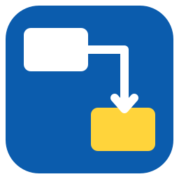

# LayoutCraft

**A free, open-source diagram editor that opens and saves Visio `.vsdx` files.** 
For Windows, macOS and Linux.

[**Download**](https://github.com/taron-sys/LayoutCraft/releases) ·
[Features](docs/48-features.md) ·
[Documentation](docs/README.md) ·
[Report a problem](https://github.com/taron-sys/LayoutCraft/issues)

*Example for stencil fidelity on LayoutCraft 0.1.0-rc.4*

> **Early preview.** LayoutCraft is young. Some drawings will not look or behave exactly as they did in the program that made
> them, so keep a copy of important files. See [known gaps](docs/07-known-gaps.md).

## What you can do with it

- **Open your diagrams:** current and older Visio formats, draw.io and Excalidraw files.
- **Edit them:** draw shapes, connect them with lines that stay attached, add text, arrange pages and layers.
- **Use stencils:** place shapes from the built-in set or from stencil files of your own.
- **Check your work:** find loose connectors and overlapping shapes, compare two files, list the data on your shapes.
- **Share the result:** save as `.vsdx`, or export to PDF, SVG, DXF, draw.io, Excalidraw or a web page.
- **Ask an AI assistant:** let an assistant that supports [MCP](https://modelcontextprotocol.io) create and change drawings for you.

Your files are opened and saved on your own computer. The editor does not upload your drawings.

## Download

Get the latest build from the [**Releases page**](https://github.com/taron-sys/LayoutCraft/releases) (open **Assets** under
the newest version).

| Your system | Pick the file ending in |
| --- | --- |
| Windows (most PCs) | `windows-x64.msi` to install, or `windows-x64-portable.zip` to run without installing |
| Windows on ARM | `windows-arm64.msi` or `windows-arm64-portable.zip` |
| macOS (Apple silicon and Intel) | `macos-universal.dmg` |
| Debian, Ubuntu | `linux-x86_64.deb` |
| Fedora, openSUSE, RHEL | `linux-x86_64.rpm` |
| Other Linux | `linux-x86_64.AppImage` or `linux-x86_64.tar.gz` |

For Linux on ARM, pick the matching `linux-aarch64` file.

### The first start

The downloads are not code-signed yet, so your system will warn you:

- **Windows:** on "Windows protected your PC", choose **More info**, then **Run anyway**.
- **macOS:** Control-click (right-click) the app, choose **Open**, then confirm.
- **Linux:** an AppImage must be made executable first (`chmod +x` and the file name). Install `.deb` and `.rpm` files with your
  package manager.

## Supported files

| Format | Open | Save or export |
| --- | :---: | :---: |
| Visio drawings and templates (`.vsdx`, `.vstx`, `.vsdm`, `.vstm`) | Yes | `.vsdx` |
| Older Visio files, 2000 and later (`.vsd`, `.vdx` and their stencil and template forms) | Yes, converted | as `.vsdx` |
| Stencils (`.vssx`) | In the Shapes pane | |
| draw.io (`.drawio`), Excalidraw (`.excalidraw`) | Yes | Yes |
| PDF, SVG, DXF, web page (`.html`) | | Yes |

Converting an older file leaves some things behind, and the app tells you what to check. Visio 5 and earlier files cannot be
opened. [Details](docs/47-legacy-formats.md).

## Use it with an AI assistant

LayoutCraft includes a small local server that lets an AI assistant (for example Claude) work with your drawings. In the app,
open **Help > AI assistant (MCP)** to get the settings to paste into your assistant. The assistant can only read and write files
in the folder you choose, so choose it with care. What the assistant reads
from your drawings is handled by that assistant's provider. [Setup guide](docs/32-mcp.md).

## Help and feedback

- Keyboard shortcuts: **Help > Keyboard shortcuts** in the app.
- Found a bug, or a file that looks wrong? [Open an issue](https://github.com/taron-sys/LayoutCraft/issues). Do not attach files
  that are private or that you may not share.
- Security problems: report them privately, as described in [SECURITY.md](SECURITY.md).

## For developers

LayoutCraft is written in Rust.

| | |
| --- | --- |
| [Building and testing](docs/49-building.md) | Build the app, the AI assistant server and the browser version |
| [Contributing](CONTRIBUTING.md) | Read this and [AGENTS.md](AGENTS.md) before you send a change |
| [Documentation](docs/README.md) | Architecture, file formats and design notes |
| [Provenance](PROVENANCE.md) | What the project claims about its sources |

## Licence

MIT OR Apache-2.0, at your option: [LICENSE-MIT](LICENSE-MIT), [LICENSE-APACHE](LICENSE-APACHE) (see also [LICENSE](LICENSE)).
Third-party components and their licences are listed in [THIRD-PARTY-NOTICES.txt](THIRD-PARTY-NOTICES.txt).

Microsoft and Visio are trademarks of Microsoft Corporation. LayoutCraft is not affiliated with or endorsed by Microsoft.
"Visio" and ".vsdx" are used only to say which file format LayoutCraft is compatible with.
